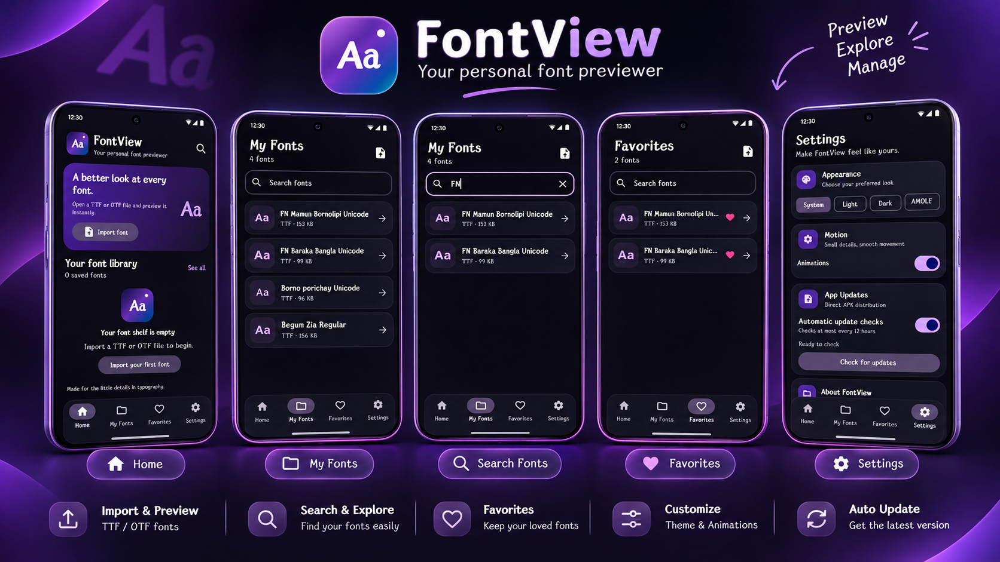
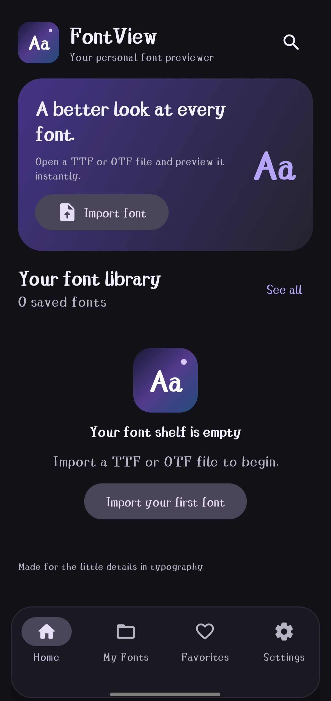
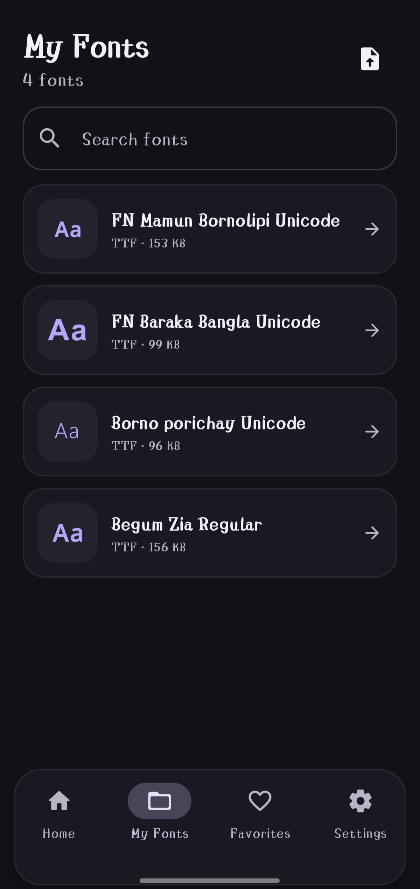
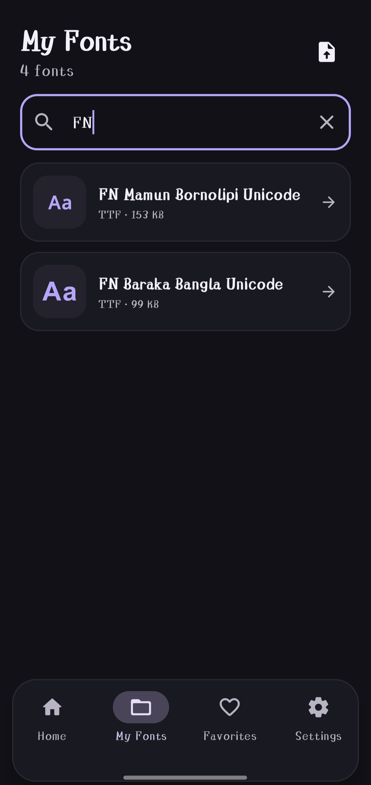
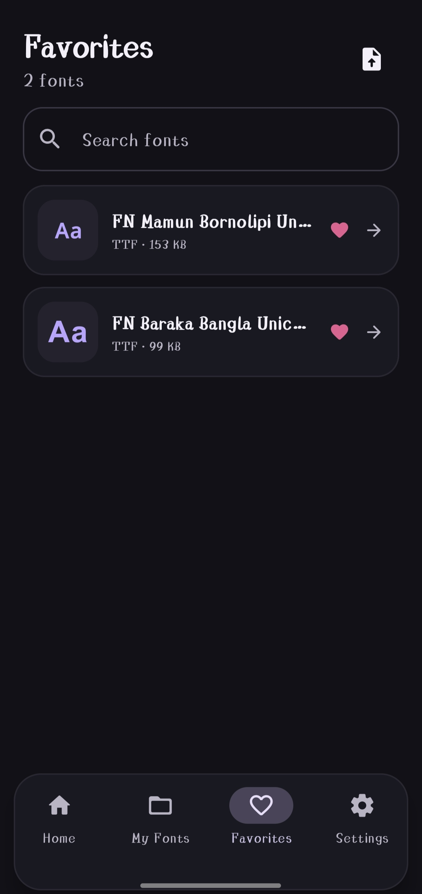
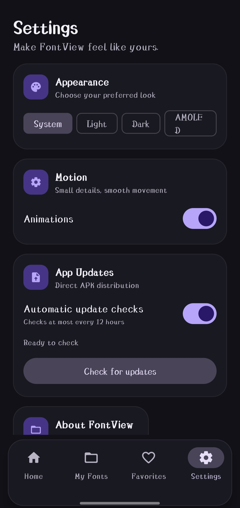

# FontView

  

<h3 align="center">Your personal font previewer</h3>

  A simple, elegant place to import, preview, search, and organize your font files.

  <a href="https://github.com/sami7fardeen/FontView-Updates/releases/latest"><strong>⬇ Download the latest APK</strong></a>
  ·
  <a href="https://github.com/sami7fardeen/FontView-Updates/releases"><strong>All releases</strong></a>

---

## ✨ What is FontView?

FontView helps you explore font files directly on your Android device. Import a **TTF** or **OTF** file, keep your fonts organized, and quickly find the ones you want to use.

## 🚀 Features

- **Import fonts** — add TTF and OTF font files from your device.
- **Personal font library** — keep imported fonts together in one place.
- **Search** — find a font by name.
- **Favorites** — save the fonts you like for quick access.
- **Choose your look** — System, Light, Dark, and AMOLED appearance options.
- **Smooth motion** — turn app animations on or off.
- **Direct app updates** — check for the latest FontView version from Settings.

## 📱 App Screenshots

## 📱 App Screenshots

  
  
  

  
  

## 📥 Download & Install

1. Open the **[latest FontView release](https://github.com/sami7fardeen/FontView-Updates/releases/latest)**.
2. Download the APK asset.
3. Open the downloaded APK on your Android device.
4. If Android asks, allow installation for the app you used to open the APK, then follow the installer prompts.

Only download FontView from this official repository.

## 🔄 Updating FontView

FontView can check for updates from **Settings → App Updates**. You can also visit the [Releases page](https://github.com/sami7fardeen/FontView-Updates/releases) to download a release manually.

## 🔐 Project & Distribution

This repository is the public home for FontView releases and its update manifest. The Android source code and signing configuration are maintained separately in the private source repository.

- Latest update manifest: [latest.json](https://raw.githubusercontent.com/sami7fardeen/FontView-Updates/main/latest.json)
- Release history: [GitHub Releases](https://github.com/sami7fardeen/FontView-Updates/releases)

---

  <strong>FontView</strong> 
  <em>Every font has a story.</em>

